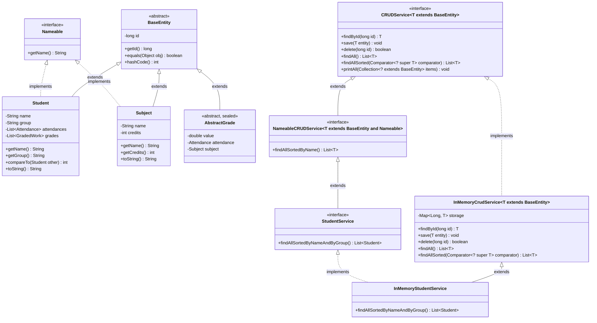

# Student Journal

Консольний застосунок для ведення студентського журналу. Проєкт реалізує типізований generic CRUD-сервіс для сутностей предметної області з гнучким сортуванням та збереженням у колекціях (Лабораторна робота №7–9), багаторівневу запечатану (`sealed`) ієрархію класів оцінюваних робіт на основі принципів наслідування (Лабораторна робота №6), архітектуру MVP та патерни проєктування Strategy, Factory Method, Observer і Adapter (ЛР №4–5).

---

## Лабораторна робота №7–9: Реалізація типізованого CRUD-сервісу: узагальнення, колекції, сортування об'єктів

### 1. Архітектура сутностей та узагальненого сервісу (Mermaid-діаграма)

У проєкті реалізовано чисту архітектуру керування сутностями (DDD / Clean Architecture):
1. **`BaseEntity`** відповідає виключно за ідентичність об'єкта в базі даних (`long id`, `equals` та `hashCode` за `id`).
2. **`Nameable`** — інтерфейс можливості для сутностей, що мають власну назву або ПІБ (`getName()`).
3. **`AbstractGrade` (Оцінка)** тепер повноцінно успадковує `BaseEntity`, отримуючи унікальний `id` для збереження в БД.
4. **`NameableCRUDService<T extends BaseEntity & Nameable>`** використовує множинні межі узагальнень (**Multiple Bounds / Intersection Types**) для надання `default`-методу `findAllSortedByName()`.



---

### 2. Рівень 1. Базовий рівень: сутності, винятки та обмеження типів

#### 2.1. Базовий клас `BaseEntity`, інтерфейс `Nameable` та сутності предметної області
- **Чиста ідентичність `BaseEntity`**:
  - Містить незмінне поле ідентифікатора `private final long id;` та контракт ідентичності `equals` / `hashCode` за первинним ключем.
  - Базовий клас не містить штучних бізнес-полів (таких як `name`), дотримуючись принципів **Single Responsibility (SRP)** та **Interface Segregation (ISP)**.
- **Інтерфейс можливості `Nameable`**:
  - Надає контракт отримання назви/імені `String getName()` для сутностей `Student` та `Subject`.
- **Оцінки як повноцінні сутності БД**:
  - `AbstractGrade` тепер успадковує `BaseEntity`, що робить оцінки повноцінними сутностями з унікальним ID, готовими до збереження в таблиці `grades` реляційної СУБД.
- **Універсальність `InMemoryCrudService<T extends BaseEntity>`**:
  - Сервіс працює з будь-якою сутністю (`Student`, `Subject`, `AbstractGrade`) без жодних змін коду.

#### 2.2. Власний виняток `EntityNotFoundException` (Checked vs Unchecked)
- `EntityNotFoundException` успадковано від **`RuntimeException` (Unchecked exception)**.
- **Обґрунтування вибору**:
  - Відсутність сутності за вказаним ідентифікатором у CRUD-сервісі найчастіше є наслідком логічної помилки викликаючого коду (невалідне посилання, застарілий ID у UI) або штатною перевірочною вимогою бізнес-логіки.
  - Використання неперевіреного винятку запобігає «забрудненню» контрактів інтерфейсів (`throws EntityNotFoundException` у кожному методі), відповідає стандартам сучасного дизайну API (Spring `ResponseStatusException`, JPA `EntityNotFoundException`) і дозволяє централізовано обробляти помилки на рівні контролера (`AppController`).

#### 2.3. Обґрунтування обмеження `T extends BaseEntity` та Multiple Bounds
- Без обмеження `<T extends BaseEntity>` типом параметра за замовчуванням був би `Object`.
- **Що було б неможливо без цього обмеження**:
  1. Всередині сервісу неможливо було б викликати метод `entity.getId()`, оскільки клас `Object` його не містить.
  2. Метод `save(T entity)` не зміг би отримати ключ для збереження в мапу `storage.put(entity.getId(), entity)`.
  3. Для сортування за ім'ям використано множинну межу узагальнень: `NameableCRUDService<T extends BaseEntity & Nameable>`. Це гарантує компілятору, що об'єкт одночасно є сутністю (`BaseEntity`) та має ім'я (`Nameable`), дозволяючи викликати `Nameable::getName` у `default`-методі сортування.
  1. Всередині сервісу неможливо було б викликати методи `entity.getId()` та `entity.getName()`, оскільки клас `Object` їх не містить.
  2. Метод `save(T entity)` не зміг би отримати ключ для збереження в мапу `storage.put(entity.getId(), entity)`.
  3. Дефолтний метод сортування `findAllSortedByName()` не зміг би побудувати компаратор `Comparator.comparing(BaseEntity::getName)`.

---

### 3. Рівень 2. Порівняння колекцій, незмінність сховища та узгодженість контрактів

#### 3.1. Порівняльна таблиця колекцій для сховища даних

Для зберігання сутностей в пам'яті проведено аналіз 4 варіантів колекцій Java:

| Операція | `ArrayList<T>` | `HashMap<Long, T>` | `LinkedHashMap<Long, T>` (Обрано) | `TreeMap<Long, T>` |
| :--- | :---: | :---: | :---: | :---: |
| **`findById(id)`** | $O(N)$ (лінійний перебір) | $O(1)$ амортизована | **$O(1)$ амортизована** | $O(\log N)$ (червоно-чорне дерево) |
| **`save(entity)`** (insert/update) | $O(N)$ (пошук + заміна/додавання) | $O(1)$ амортизована | **$O(1)$ амортизована** | $O(\log N)$ |
| **`delete(id)`** | $O(N)$ (пошук + зсув елементів) | $O(1)$ амортизована | **$O(1)$ амортизована** | $O(\log N)$ |
| **Сортований вивід за назвою** | $O(N \log N)$ (копія + TimSort) | $O(N \log N)$ (копія + TimSort) | **$O(N \log N)$ (копія + TimSort)** | $O(N)$ за ключем (але за назвою все одно $O(N \log N)$) |
| **Збереження порядку вставки** | Так | Ні (хаотичний порядок бакетів) | **Так (двозв'язний список хеш-таблиці)** | Ні (порядок натурального сортування ключів) |

**Обґрунтування вибору `LinkedHashMap`**:
1. На відміну від `ArrayList`, операції CRUD (`findById`, `save`, `delete`) виконуються за константний час $O(1)$ завдяки хешуванню ідентифікатора.
2. На відміну від звичайного `HashMap`, `LinkedHashMap` додатково підтримує внутрішній двозв'язний список записів, що гарантує **передбачуваний та детермінований порядок обходу елементів за порядком їх додавання (insertion order)**. Це критично для відображення даних користувачу та стабільності тестування.
3. `TreeMap` дає виграш тільки при потребі постійного сортування за числовим ID ($O(\log N)$ на кожну модифікацію), проте сортування за ім'ям сутності все одно вимагає повного сортування значень $O(N \log N)$.

#### 3.2. Сортування: `Comparable` проти `Comparator`
- **Чому для сортування за назвою обрано `Comparator`**:
  - `Comparable` задає лише один жорстко вшитий «природний» порядок сортування всередині класу.
  - `Comparator` реалізує патерн Strategy, відокремлює логіку порівняння від класу сутності, дозволяє передавати різні правила сортування на льоту і комбінувати їх через `thenComparing`.
- **Вторинне сортування за назвою та групою**:
  - В інтерфейсі `StudentService` оголошено метод `findAllSortedByNameAndByGroup()`.
  - Реалізовано через ланцюжок компараторів: `Comparator.comparing(Student::getName).thenComparing(Student::getGroup)`.
  - Якщо імена двох студентів збігаються, порівнюється їхня академічна група (наприклад, група `"КН-21"` передує `"КН-22"`).
- **Гарантія незмінності сховища**:
  - Метод `findAllSorted(...)` створює **нову копію списку** (`new ArrayList<>(storage.values())`), сортує її та повертає `Collections.unmodifiableList(list)`.
  - Порядок і склад елементів у внутрішній `LinkedHashMap` сховища залишаються незмінними.

#### 3.3. Контракт `equals()`, `hashCode()` та узгодженість з `compareTo`
- У `BaseEntity` методи `equals()` та `hashCode()` перевизначено **виключно за полем `id`**. Сутності є об'єктами з ідентичністю (Identity Objects): два студенти з однаковими іменами є різними сутностями, якщо в них різні `id`.
- **Узгодженість `compareTo` з `equals`**:
  - Натуральний порядок називається *узгодженим з equals*, якщо `e1.compareTo(e2) == 0` тоді і тільки тоді, коли `e1.equals(e2) == true`.
  - При сортуванні за ім'ям два студенти з різними ID мають однакове ім'я (`compare == 0`), проте `equals == false`. Отже, сортування за ім'ям є **НЕУЗГОДЖЕНИМ з equals**.
  - **Наслідок**: таку колекцію не можна використовувати як основу для `TreeSet<Student>` з компаратором за ім'ям, інакше `TreeSet` вважатиме студентів з однаковим ім'ям дублікатами і **видалить (проігнорує) другого студента**, навіть якщо це зовсім різні люди з різними ID.

---

### 4. Рівень 3. Високий рівень: Generics, Wildcards та PECS

#### 4.1. Узагальнене сортування та принцип PECS (`Comparator<? super T>`)
- У `CRUDService<T>` додано метод:
  ```java
  List<T> findAllSorted(Comparator<? super T> comparator);
  ```
- **Чому `Comparator<? super T>`, а не `Comparator<T>`**:
  - Застосовано принцип **PECS (Producer Extends, Consumer Super)**: компаратор є *споживачем (Consumer)* об'єктів типу `T`, оскільки він приймає їх аргументами методу `compare(T o1, T o2)` для порівняння.
  - Завдяки `? super T` ми можемо передати компаратор, оголошений для базового класу `Comparator<BaseEntity>`, у виклик `findAllSorted` для сервісу нащадка `CRUDService<Student>`. Якби параметр мав тип `Comparator<T>`, передача `Comparator<BaseEntity>` викликала б помилку компіляції через інваріантність узагальнень у Java.

#### 4.2. Метод `findAllSortedByName()` як `default`-метод інтерфейсу
- Метод `findAllSortedByName()` оголошено в інтерфейсі `CRUDService<T>` як `default`:
  ```java
  default List<T> findAllSortedByName() {
      return findAllSorted(Comparator.comparing(BaseEntity::getName));
  }
  ```
- Завдяки модифікатору `default` жодному класу-реалізації не потрібно дублювати цей код: реалізація делегується універсальному `findAllSorted`.

#### 4.3. Утилітний метод `printAll(Collection<? extends BaseEntity> items)`
- Створено метод:
  ```java
  public static void printAll(Collection<? extends BaseEntity> items);
  ```
- **Чому `List<Student>` не можна передати в `List<BaseEntity>`**:
  - У Java параметризовані типи є **інваріантними**: хоча `Student` є підтипом `BaseEntity`, тип `List<Student>` **не є підтипом** `List<BaseEntity>`.
  - Якби Java дозволяла передавати `List<Student>` у змінну `List<BaseEntity>`, викликаючий код міг би написати `list.add(new Subject("Java"))`, що призвело б до падіння JVM з `ClassCastException` під час читання зі списку студентів (Heap Pollution).
- **Роль wildcard `? extends BaseEntity` (Коваріантність)**:
  - Запис `Collection<? extends BaseEntity>` вказує компілятору, що колекція є джерелом (Producer) елементів типу `BaseEntity`. Метод `printAll` лише читає елементи, тому передача `List<Student>` або `List<Subject>` стає повністю безпечною та валідною.

---

---

## Лабораторна робота №6: Реалізація ієрархії класів на основі принципів наслідування

### 1. Трирівнева запечатана ієрархія класів (`is-a`) та Mermaid-діаграма (п. 1, 6, 11, 12)

Кожна ланка ієрархії проходить перевірку відношенням **«є різновидом» (`is-a`)**:
- `RegularGrade` (оцінка за звичайну пару) **є різновидом** `AbstractGrade` (абстрактної оцінки в журналі);
- `LabGrade` (оцінка за лабораторну роботу) **є різновидом** `AbstractGrade`;
- `ExamGrade` (екзаменаційна оцінка) **є різновидом** `AbstractGrade`;
- `DefenseLabGrade` (оцінка за лабораторну роботу із захистом, **3-й рівень ієрархії**) **є різновидом** `LabGrade`.


---

### 2. Інкапсуляція, абстрактний базовий клас та абстрактні методи (п. 2, 5)

- **Розподіл полів (`private`)**:
  - У базовий клас `AbstractGrade` винесено спільний стан усіх оцінок: `private final double value`, `private final Attendance attendance`, `private final Subject subject` та валідацію діапазону `0..100`.
  - У підкласах залишено лише специфічні поля (`private final int labNumber` у `LabGrade`, `private final double defenseBonus` у `DefenseLabGrade`, `private final int ticketNumber` у `ExamGrade`). Усі поля є `private`, що зберігає сувору інкапсуляцію.
- **Чому `AbstractGrade` та його методи абстрактні**:
  - У предметній області не існує «просто абстрактної оцінки без типу заняття», тому створення екземпляра `new AbstractGrade(...)` не має сенсу.
  - Методи `getEffectiveScore()`, `isPassed()` та `getWorkType()` оголошені як `abstract`, оскільки формула розрахунку ефективного балу та порогу складання залежить виключно від конкретного різновиду заняття (штраф `-20%` за пропуск у `LabGrade`, бонус захисту в `DefenseLabGrade`, коефіцієнт `x2.0` та поріг `60` в `ExamGrade`).

---

### 3. Ланцюжок конструкторів (`super`, `this`) та перевизначення `toString()` (п. 3, 4, 6, 7)

- **Порядок виконання конструкторів у 3-рівневій ієрархії**:
  При створенні `new DefenseLabGrade(...)` конструктори викликаються знизу вгору через `super(...)`, але тіла конструкторів виконуються **згори донизу** (від предка до нащадка):
  1. `[Конструктор 1-й рівень] AbstractGrade` — валідує та ініціалізує `value`, `attendance`, `subject`;
  2. `[Конструктор 2-й рівень] LabGrade` — ініціалізує `labNumber`;
  3. `[Конструктор 3-й рівень] DefenseLabGrade` — валідує та ініціалізує `defenseBonus`.
- **Делегування через `this(...)`**:
  У класах `AbstractGrade`, `RegularGrade`, `LabGrade`, `DefenseLabGrade` та `ExamGrade` реалізовано перевантажені конструктори, які делегують ініціалізацію основному конструктору через `this(...)` зі значеннями за замовчуванням (`DEFAULT_SCORE`, `DEFAULT_LAB_NUMBER`, `DEFAULT_DEFENSE_BONUS`, `DEFAULT_TICKET_NUMBER`), уникаючи дублювання коду перевірок.
- **Ланцюжок `super.toString()`**:
  Кожен підклас перевизначає `@Override public String toString()`, викликаючи `super.toString()` і доповнюючи результат власними специфічними полями (`Лаб №...`, `Бонус захисту: +...`, `Білет №...`).

---

### 4. Обґрунтування модифікатора `final` (п. 8)

- **`final`-методи**: у `AbstractGrade` методи `getRawValue()`, `getAttendance()`, `getSubject()`, `getDate()`, `wasPresent()` та у `LabGrade` метод `getLabNumber()` позначені як `final`. Це гарантує, що жоден підклас не зможе підмінити первинний факт виставленого балу, предмет або запис про присутність студента.
- **`final`-класи**: листові класи ієрархії (`RegularGrade`, `ExamGrade`, `DefenseLabGrade`) та ціннісний об'єкт `Subject` оголошені `final`, оскільки вони завершують відповідні гілки спеціалізації (і є фінальними вузлами `sealed`-ієрархії).

---

### 5. Статичний і динамічний типи об'єкта (п. 9, Рівень 2)

- **Статичний (оголошений) тип** — це тип змінної або посилання, відомий компілятору під час компіляції (наприклад, `AbstractGrade grade`). Він визначає, які саме методи дозволено викликати напряму через цю змінну.
- **Динамічний (фактичний) тип** — це реальний клас об'єкта в купі (heap) під час виконання програми (наприклад, `DefenseLabGrade` або `ExamGrade`). Він визначає, яка саме перевизначена реалізація методу буде викликана під час dynamic dispatch.
- Щоб викликати специфічний метод підкласу (`getLabNumber()`, `getDefenseBonus()`, `getTicketNumber()`) через посилання базового типу `AbstractGrade`, використовується перевірка `if (grade instanceof DefenseLabGrade defenseLab)` з pattern matching.

---

### 6. Контракт `equals()` і `hashCode()`: симетрія, `getClass()` проти `instanceof` (п. 9, Рівень 3)

- Якщо в `equals()` базового класу (`LabGrade`) використати перевірку `instanceof`, а в підкласі (`DefenseLabGrade`) додати нове значуще поле (`defenseBonus`), виникає **порушення симетрії**:
  - `baseLab.equalsUsingInstanceof(subLab)` повертає `true` (оскільки `DefenseLabGrade instanceof LabGrade` є істинним, а базові поля та номер лабораторної збігаються);
  - `subLab.equalsUsingInstanceof(baseLab)` повертає `false` (оскільки `baseLab` не є екземпляром `DefenseLabGrade` і не має бонусу захисту).
- **Обґрунтування вибору `getClass()`**: у робочих методах `equals()` ієрархії `AbstractGrade` використано строгу перевірку `getClass() != obj.getClass()`. Завдяки цьому `baseLab.equals(subLab)` та `subLab.equals(baseLab)` обидва повертають `false`, що повністю зберігає **рефлексивність, симетрію і транзитивність** контракту `Object.equals()` та коректну роботу геш-колекцій (`HashSet`, `HashMap`).

---

### 7. Композиція (`has-a`) замість наслідування (`is-a`) (п. 10)

У проєкті композиція застосована замість наслідування у трьох ключових місцях:
1. **`AbstractGrade` містить `Attendance` та `Subject` (`has-a`)**: оцінка **має** запис про відвідуваність і **має** предмет, але оцінка **не є** відвідуваністю чи предметом. Якби `AbstractGrade` успадковував `Attendance`, одна відвідуваність не могла б існувати без оцінки, а зміна присутності або перевизначення методів зламали б інкапсуляцію журналу відвідування.
2. **`SchoolGradeAdapter` містить `SchoolAssessment` (`has-a`)**: адаптер обгортає зовнішню 12-бальну оцінку через композицію (Object Adapter), реалізуючи інтерфейс `GradedWork`. Якби ми спробували успадкувати `SchoolAssessment` від `AbstractGrade`, виник би конфлікт шкал оцінювання (12-бальна проти 100-бальної валідації в конструкторі `AbstractGrade`).
3. **`Journal` містить `GradingStrategy` (`has-a`)**: журнал делегує розрахунок рейтингу об'єкту-стратегії, що дозволяє змінювати алгоритм у runtime без перестворення об'єкта журналу (що було б неможливим при жорсткому наслідуванні `StandardJournal extends Journal`).

---

### 8. Запечатана ієрархія (`sealed`) та вичерпний `switch` з Pattern Matching (п. 12)

- Клас `AbstractGrade` оголошено як `public abstract sealed class AbstractGrade implements GradedWork permits RegularGrade, LabGrade, ExamGrade`, а `LabGrade` — як `public sealed class LabGrade extends AbstractGrade permits DefenseLabGrade`.
- **Гарантія компілятора**: модифікатор `sealed` фіксує закритий перелік допустимих підкласів на етапі компіляції. Завдяки цьому компілятор Java 21+ гарантує **вичерпність (exhaustiveness)** конструкції `switch (grade)` з pattern matching без гілки `default`. Якщо в майбутньому до `permits` буде додано новий підклас, компілятор одразу вкаже на всі `switch`-вирази, де новий тип не оброблено.

---

## Компіляція та запуск

Виконуйте команди з кореня проєкту (`result/Labs`):

```powershell
Remove-Item -Recurse -Force out -ErrorAction SilentlyContinue
javac -encoding UTF-8 -d out (Get-ChildItem -Recurse src -Filter *.java).FullName
java "-Dfile.encoding=UTF-8" "-Dsun.stdout.encoding=UTF-8" -cp out journal.Main
```

Для автоматичного прогону демонстраційного сценарію:

```powershell
Get-Content ..\..\work\demo_input.txt | java "-Dfile.encoding=UTF-8" "-Dsun.stdout.encoding=UTF-8" -cp out journal.Main
```

## Меню програми

```text
1  - Додати студента
2  - Показати всіх студентів (з балами за активною стратегією)
3  - Додати оцінку за заняття (Звичайна / Лабораторна / Іспит / Захист лаб.)
4  - Показати всі оцінки студента
5  - Додати відвідуваність
6  - Показати відвідуваність студента
7  - Сортувати студентів за балом активної стратегії (Bubble Sort)
8  - Підсумок (студенти з підсумковим балом >= 60)
9  - Пошук студента
10 - Змінити стратегію оцінювання групи (Strategy Pattern)
11 - Демонстрація поліморфізму та ієрархії наслідування (ЛР №6)
12 - Імпорт шкільної 12-бальної оцінки (Adapter Pattern)
13 - Демонстрація типізованого CRUD-сервісу та узагальнень (ЛР №7-9)
0  - Вихід
```