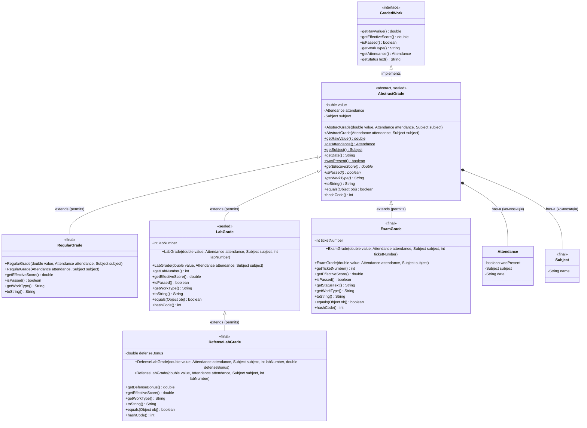

# Student Journal

Консольний застосунок для ведення студентського журналу. Проєкт реалізує багаторівневу запечатану (`sealed`) ієрархію класів оцінюваних робіт на основі принципів наслідування (Лабораторна робота №6), архітектуру MVP та патерни проєктування Strategy, Factory Method, Observer і Adapter (ЛР №4–5).

---

## Лабораторна робота №6: Реалізація ієрархії класів на основі принципів наслідування

### 1. Трирівнева запечатана ієрархія класів (`is-a`) та Mermaid-діаграма (п. 1, 6, 11, 12)

Кожна ланка ієрархії проходить перевірку відношенням **«є різновидом» (`is-a`)**:
- `RegularGrade` (оцінка за звичайну пару) **є різновидом** `AbstractGrade` (абстрактної оцінки в журналі);
- `LabGrade` (оцінка за лабораторну роботу) **є різновидом** `AbstractGrade`;
- `ExamGrade` (екзаменаційна оцінка) **є різновидом** `AbstractGrade`;
- `DefenseLabGrade` (оцінка за лабораторну роботу із захистом, **3-й рівень ієрархії**) **є різновидом** `LabGrade`.



---

### 2. Інкапсуляція, абстрактний базовий клас та абстрактні методи (п. 2, 5)

- **Розподіл полів (`private`)**:
  - У базовий клас `AbstractGrade` винесено спільний стан усіх оцінок: `private final double value`, `private final Attendance attendance`, `private final Subject subject` та валідацію діапазону `0..100`.
  - У підкласах залишено лише специфічні поля (`private final int labNumber` у `LabGrade`, `private final double defenseBonus` у `DefenseLabGrade`, `private final int ticketNumber` у `ExamGrade`). Усі поля є `private`, що зберігає сувору інкапсуляцію.
- **Чому `AbstractGrade` та його методи абстрактні**:
  - У предметній області не існує «просто абстрактної оцінки без типу заняття», тому створення екземпляра `new AbstractGrade(...)` не має сенсу.
  - Методи `getEffectiveScore()`, `isPassed()` та `getWorkType()` оголошені як `abstract`, оскільки формула розрахунку ефективного балу та порогу складання залежить виключно від конкретного різновиду заняття (штраф `-20%` за пропуск у `LabGrade`, бонус захисту в `DefenseLabGrade`, коефіцієнт `x2.0` та поріг `60` в `ExamGrade`).

---

### 3. Ланцюжок конструкторів (`super`, `this`) та перевизначення `toString()` (п. 3, 4, 6, 7)

- **Порядок виконання конструкторів у 3-рівневій ієрархії**:
  При створенні `new DefenseLabGrade(...)` конструктори викликаються знизу вгору через `super(...)`, але тіла конструкторів виконуються **згори донизу** (від предка до нащадка):
  1. `[Конструктор 1-й рівень] AbstractGrade` — валідує та ініціалізує `value`, `attendance`, `subject`;
  2. `[Конструктор 2-й рівень] LabGrade` — ініціалізує `labNumber`;
  3. `[Конструктор 3-й рівень] DefenseLabGrade` — валідує та ініціалізує `defenseBonus`.
- **Делегування через `this(...)`**:
  У класах `AbstractGrade`, `RegularGrade`, `LabGrade`, `DefenseLabGrade` та `ExamGrade` реалізовано перевантажені конструктори, які делегують ініціалізацію основному конструктору через `this(...)` зі значеннями за замовчуванням (`DEFAULT_SCORE`, `DEFAULT_LAB_NUMBER`, `DEFAULT_DEFENSE_BONUS`, `DEFAULT_TICKET_NUMBER`), уникаючи дублювання коду перевірок.
- **Ланцюжок `super.toString()`**:
  Кожен підклас перевизначає `@Override public String toString()`, викликаючи `super.toString()` і доповнюючи результат власними специфічними полями (`Лаб №...`, `Бонус захисту: +...`, `Білет №...`).

---

### 4. Обґрунтування модифікатора `final` (п. 8)

- **`final`-методи**: у `AbstractGrade` методи `getRawValue()`, `getAttendance()`, `getSubject()`, `getDate()`, `wasPresent()` та у `LabGrade` метод `getLabNumber()` позначені як `final`. Це гарантує, що жоден підклас не зможе підмінити первинний факт виставленого балу, предмет або запис про присутність студента.
- **`final`-класи**: листові класи ієрархії (`RegularGrade`, `ExamGrade`, `DefenseLabGrade`) та ціннісний об'єкт `Subject` оголошені `final`, оскільки вони завершують відповідні гілки спеціалізації (і є фінальними вузлами `sealed`-ієрархії).

---

### 5. Статичний і динамічний типи об'єкта (п. 9, Рівень 2)

- **Статичний (оголошений) тип** — це тип змінної або посилання, відомий компілятору під час компіляції (наприклад, `AbstractGrade grade`). Він визначає, які саме методи дозволено викликати напряму через цю змінну.
- **Динамічний (фактичний) тип** — це реальний клас об'єкта в купі (heap) під час виконання програми (наприклад, `DefenseLabGrade` або `ExamGrade`). Він визначає, яка саме перевизначена реалізація методу буде викликана під час dynamic dispatch.
- Щоб викликати специфічний метод підкласу (`getLabNumber()`, `getDefenseBonus()`, `getTicketNumber()`) через посилання базового типу `AbstractGrade`, використовується перевірка `if (grade instanceof DefenseLabGrade defenseLab)` з pattern matching.

---

### 6. Контракт `equals()` і `hashCode()`: симетрія, `getClass()` проти `instanceof` (п. 9, Рівень 3)

- Якщо в `equals()` базового класу (`LabGrade`) використати перевірку `instanceof`, а в підкласі (`DefenseLabGrade`) додати нове значуще поле (`defenseBonus`), виникає **порушення симетрії**:
  - `baseLab.equalsUsingInstanceof(subLab)` повертає `true` (оскільки `DefenseLabGrade instanceof LabGrade` є істинним, а базові поля та номер лабораторної збігаються);
  - `subLab.equalsUsingInstanceof(baseLab)` повертає `false` (оскільки `baseLab` не є екземпляром `DefenseLabGrade` і не має бонусу захисту).
- **Обґрунтування вибору `getClass()`**: у робочих методах `equals()` ієрархії `AbstractGrade` використано строгу перевірку `getClass() != obj.getClass()`. Завдяки цьому `baseLab.equals(subLab)` та `subLab.equals(baseLab)` обидва повертають `false`, що повністю зберігає **рефлексивність, симетрію і транзитивність** контракту `Object.equals()` та коректну роботу геш-колекцій (`HashSet`, `HashMap`).

---

### 7. Композиція (`has-a`) замість наслідування (`is-a`) (п. 10)

У проєкті композиція застосована замість наслідування у трьох ключових місцях:
1. **`AbstractGrade` містить `Attendance` та `Subject` (`has-a`)**: оцінка **має** запис про відвідуваність і **має** предмет, але оцінка **не є** відвідуваністю чи предметом. Якби `AbstractGrade` успадковував `Attendance`, одна відвідуваність не могла б існувати без оцінки, а зміна присутності або перевизначення методів зламали б інкапсуляцію журналу відвідування.
2. **`SchoolGradeAdapter` містить `SchoolAssessment` (`has-a`)**: адаптер обгортає зовнішню 12-бальну оцінку через композицію (Object Adapter), реалізуючи інтерфейс `GradedWork`. Якби ми спробували успадкувати `SchoolAssessment` від `AbstractGrade`, виник би конфлікт шкал оцінювання (12-бальна проти 100-бальної валідації в конструкторі `AbstractGrade`).
3. **`Journal` містить `GradingStrategy` (`has-a`)**: журнал делегує розрахунок рейтингу об'єкту-стратегії, що дозволяє змінювати алгоритм у runtime без перестворення об'єкта журналу (що було б неможливим при жорсткому наслідуванні `StandardJournal extends Journal`).

---

### 8. Запечатана ієрархія (`sealed`) та вичерпний `switch` з Pattern Matching (п. 12)

- Клас `AbstractGrade` оголошено як `public abstract sealed class AbstractGrade implements GradedWork permits RegularGrade, LabGrade, ExamGrade`, а `LabGrade` — як `public sealed class LabGrade extends AbstractGrade permits DefenseLabGrade`.
- **Гарантія компілятора**: модифікатор `sealed` фіксує закритий перелік допустимих підкласів на етапі компіляції. Завдяки цьому компілятор Java 21+ гарантує **вичерпність (exhaustiveness)** конструкції `switch (grade)` з pattern matching без гілки `default`. Якщо в майбутньому до `permits` буде додано новий підклас, компілятор одразу вкаже на всі `switch`-вирази, де новий тип не оброблено.

---

## Компіляція та запуск

Виконуйте команди з кореня проєкту (`result/Labs`):

```powershell
Remove-Item -Recurse -Force out -ErrorAction SilentlyContinue
javac -encoding UTF-8 -d out (Get-ChildItem -Recurse src -Filter *.java).FullName
java "-Dfile.encoding=UTF-8" "-Dsun.stdout.encoding=UTF-8" -cp out journal.Main
```

Для автоматичного прогону демонстраційного сценарію:

```powershell
Get-Content ..\..\work\demo_input.txt | java "-Dfile.encoding=UTF-8" "-Dsun.stdout.encoding=UTF-8" -cp out journal.Main
```

## Меню програми

```text
1  - Додати студента
2  - Показати всіх студентів (з балами за активною стратегією)
3  - Додати оцінку за заняття (Звичайна / Лабораторна / Іспит / Захист лаб.)
4  - Показати всі оцінки студента
5  - Додати відвідуваність
6  - Показати відвідуваність студента
7  - Сортувати студентів за балом активної стратегії (Bubble Sort)
8  - Підсумок (студенти з підсумковим балом >= 60)
9  - Пошук студента
10 - Змінити стратегію оцінювання групи (Strategy Pattern)
11 - Демонстрація поліморфізму та ієрархії наслідування (ЛР №6)
12 - Імпорт шкільної 12-бальної оцінки (Adapter Pattern)
0  - Вихід
```